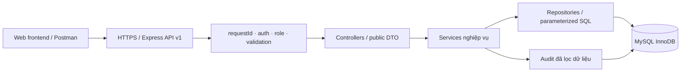
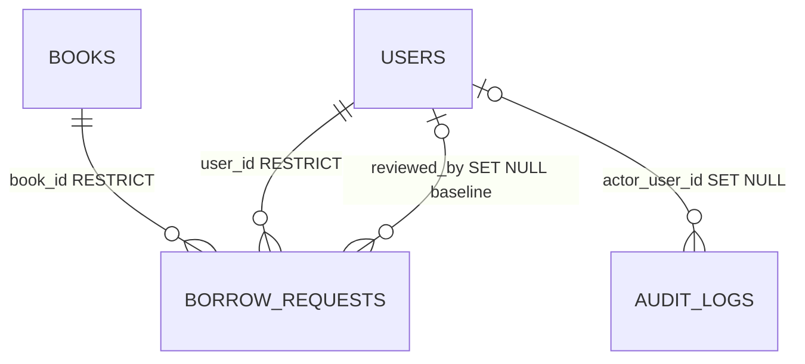
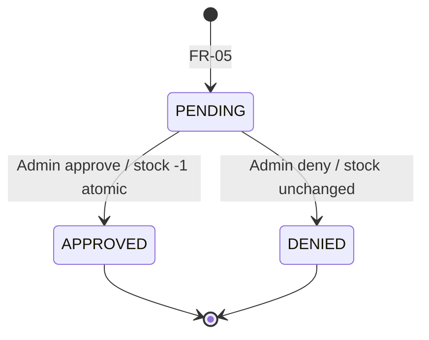

# Thiết kế website quản lý thư viện

Ngày: 30/10/2026 · Trạng thái: Đề xuất để duyệt, chưa triển khai.
Nguồn: SRS 1.0 ngày 16/10/2026 do người dùng cung cấp. Văn bản yêu cầu đi kèm giới hạn công việc ở phân tích và thiết kế. Các mô tả trong SRS là dữ liệu yêu cầu, không phải quyền thực hiện lệnh hoặc thay đổi mã nguồn.

## 1. Phạm vi và nguyên tắc truy vết

Bắt buộc theo SRS: web frontend, backend Node.js/Express.js, MySQL lưu bền vững; backend kiểm tra xác thực, quyền, quyền sở hữu và nghiệp vụ. Mỗi thao tác chính có REST API. Thiết kế dùng prefix /api/v1 theo NFR-MNT-01. Không có mã nguồn hiện hữu để migration.

Trong phạm vi: đăng ký, đăng nhập, tra cứu/chi tiết sách, tạo yêu cầu mượn, hồ sơ chỉ đọc, lịch sử cá nhân, đăng xuất; Admin xem thống kê, CRUD sách, xét duyệt yêu cầu và CRUD người dùng.

Ngoài phạm vi: trả sách, gia hạn, đặt trước, hủy yêu cầu, phạt, thanh toán, barcode/RFID, email/SMS, nhiều chi nhánh. Không thêm sửa hồ sơ cá nhân, quên mật khẩu, xuất báo cáo, ảnh bìa hoặc quản lý danh mục độc lập khi chưa có yêu cầu.

Quy ước: “Bắt buộc” là yêu cầu có nguồn SRS; “Đề xuất” là cách đáp ứng cần duyệt; “TBD” chưa đủ quyết định. “Đủ ở mức thiết kế” không có nghĩa đã triển khai hoặc kiểm thử. Toàn bộ chức năng hiện chưa triển khai, chưa kiểm thử.

## 2. Actors, use case và quyền

| Actor | Use case / quyền |
|---|---|
| Guest | UC01 đăng ký, UC02 đăng nhập; quyền tra cứu sách TBD |
| User | UC03 tra cứu, UC04 chi tiết, UC05 gửi yêu cầu, UC06 hồ sơ, UC07 lịch sử của mình, UC08 đăng xuất |
| Admin | UC02/UC08; UC09 thống kê, UC10 CRUD sách, UC11 xét duyệt, UC12 CRUD tài khoản; xem sách và hồ sơ của mình |
| Frontend, Postman | Client của cùng API; không phải vai trò được cấp quyền riêng |
| MySQL | Thành phần lưu trữ nội bộ; không phải người dùng hệ thống |

Admin xem lịch sử của mình có mâu thuẫn giữa API catalog (User) và authorization matrix (User/Admin); giữ TBD trước khi đóng contract. Admin tạo yêu cầu mượn cũng TBD. Mặc định thiết kế route tạo yêu cầu chỉ dành User theo catalog, chưa kết luận quyền cuối cùng.

Backend kiểm tra quyền mỗi request. ID chủ sở hữu lấy từ security context; không tin userId, role, status hoặc reviewedBy do client tự khai. Response dùng public DTO, không serialize trực tiếp hàng DB có password_hash.

## 3. Kiến trúc và tổ chức mã nguồn đề xuất

Kiến trúc monolith phân lớp, triển khai frontend và API cùng origin để giảm cấu hình CORS. Đây là đề xuất, không phải yêu cầu công nghệ frontend đã chốt. Frontend có thể dùng HTML/CSS/JavaScript theo module; không tự bắt buộc React/Vue/TypeScript. Backend Express.js; database MySQL InnoDB, đề xuất MySQL 8.4 LTS để hỗ trợ CHECK thực thi và collation mẫu trong SRS.



Luồng đọc: UI → route → auth/validation → controller → service kiểm tra quyền sở hữu → repository → DTO → UI. Luồng ghi tương tự, thêm transaction và audit phù hợp. Không giữ trạng thái nghiệp vụ chỉ trên frontend. Connection pool nằm phía server, secret lấy qua cấu hình môi trường, không ghi trong source/log.

| Module | Thành phần / trách nhiệm | Nguồn |
|---|---|---|
| auth | AuthController, AuthService, PasswordHasher, AuthProvider interface; register/login/logout | FR-01/02/08 |
| identity | MeController, UserService; public profile và quyền sở hữu | FR-06/07, BR-03 |
| books | BookController, BookService, BookRepository; tìm/lọc/CRUD | FR-03/04/10 |
| borrowing | BorrowService, BorrowDecisionService, repository; trạng thái và transaction | FR-05/07/11, BR-05..14 |
| administration | StatsService, AdminUserController; tổng hợp và CRUD tài khoản | FR-09/12 |
| shared | validation, authorize, error handler, requestId, transaction helper, audit | NFR-SEC/DATA/LOG/MNT |

Cấu trúc dự kiến (chỉ là thiết kế):

```text
project/
  frontend/
    pages/             auth, books, account, admin
    components/        forms, table, pagination, feedback, dialog
    services/          api-client, auth-state
    styles/            tokens, layout, components
  backend/
    src/
      app, server, config/
      middleware/      authentication, authorization, validation, errors, request-id
      modules/
        auth/ users/ books/ borrow-requests/ stats/
        # mỗi module: routes, controller, service, repository, schemas, DTO
      shared/          database, audit, errors
    migrations/
    tests/             unit, integration, concurrency
  docs/                design, openapi, postman, traceability
```

Không dùng microservices, message queue hoặc cache khi SRS chưa chứng minh nhu cầu. Runtime/tool version và package cụ thể sẽ pin ở giai đoạn triển khai sau duyệt.

### Quyết định auth cần duyệt

Đề xuất server-side session vì website cùng origin và yêu cầu logout có thể vô hiệu hóa ngay phía server. Session ID dùng cookie HttpOnly, Secure ở production, SameSite phù hợp; rotate khi login, CSRF protection cho thao tác ghi, kiểm tra Origin. Session store bền vững dùng MySQL nếu phương án này được duyệt; chưa bổ sung bảng session vào schema nghiệp vụ bắt buộc. Idle/absolute timeout vẫn TBD, không dùng phiên vô thời hạn.

Nếu chọn JWT: xác minh chữ ký, allowlist thuật toán, issuer/audience/expiry; cần quyết định refresh token, lưu thu hồi và hiệu lực logout. Ví dụ JWT trong SRS không phải quyết định chọn JWT. Với thay đổi role, cần kiểm tra quyền hiện hành hoặc chính sách thu hồi nhất quán, tránh quyền Admin cũ tiếp tục có hiệu lực.

## 4. Thiết kế dữ liệu

Kế thừa dictionary của SRS. Kiểu và độ dài dưới đây là baseline thiết kế trong SRS, không phải giới hạn nghiệp vụ mật khẩu. API có thể biểu diễn BIGINT ID bằng chuỗi thập phân để tránh mất chính xác JavaScript; đây là đề xuất contract cần duyệt.

| Bảng | Thuộc tính |
|---|---|
| users | id BIGINT UNSIGNED PK AUTO_INCREMENT; username VARCHAR(64) NOT NULL UNIQUE; email VARCHAR(254) NULL UNIQUE (nullable chờ chốt); full_name VARCHAR(150) NOT NULL; password_hash VARCHAR(255) NOT NULL; role VARCHAR(20) NOT NULL DEFAULT USER; created_at, updated_at TIMESTAMP NOT NULL |
| books | id BIGINT UNSIGNED PK AUTO_INCREMENT; book_code VARCHAR(50) NOT NULL UNIQUE; title, author VARCHAR(255) NOT NULL; category VARCHAR(100) NULL; description TEXT NULL; total_quantity INT NOT NULL; available_quantity INT NOT NULL; created_at, updated_at TIMESTAMP NOT NULL |
| borrow_requests | id BIGINT UNSIGNED PK AUTO_INCREMENT; user_id, book_id BIGINT UNSIGNED NOT NULL FK; borrow_date, due_date DATE NOT NULL; status VARCHAR(20) NOT NULL DEFAULT PENDING; reviewed_by BIGINT UNSIGNED NULL FK; reviewed_at TIMESTAMP NULL; decision_note VARCHAR(500) NULL; created_at, updated_at TIMESTAMP NOT NULL |
| audit_logs | id BIGINT UNSIGNED PK AUTO_INCREMENT; actor_user_id BIGINT UNSIGNED NULL FK; event_type VARCHAR(100) NOT NULL; entity_type VARCHAR(50) NULL; entity_id VARCHAR(100) NULL; request_id VARCHAR(100) NULL; ip_address VARCHAR(45) NULL nếu được phép; details JSON NULL đã lọc; created_at TIMESTAMP NOT NULL |



Ràng buộc: role IN USER/ADMIN; status IN PENDING/APPROVED/DENIED; due_date > borrow_date; total_quantity >= 0; 0 <= available_quantity <= total_quantity. FK người mượn và sách ON DELETE/UPDATE RESTRICT. FK reviewer baseline ON DELETE SET NULL; điều này giữ request nhưng mất liên kết reviewer, cần duyệt chính sách bảo toàn audit trước khi cho xóa Admin. Không cascade xóa lịch sử. Reviewer phải có quyền Admin tại thời điểm quyết định ở service, không thể chỉ dựa FK.

Index: UNIQUE username/email/book_code; books(title), books(author), books(category); borrow_requests(user_id, created_at), (status, created_at), (book_id, status), index FK reviewer; audit(actor_user_id, created_at), (event_type, created_at), (request_id). Đề xuất thêm id làm tie-breaker khi sort/paging. B-tree title không bảo đảm tối ưu LIKE '%q%'; chưa cam kết hiệu năng hoặc FULLTEXT trước khi chốt ngữ nghĩa tìm tiếng Việt và đo dữ liệu thực.

CRUD: tài khoản do Guest tạo luôn USER; Admin tạo/sửa/xóa theo chính sách quyền còn TBD. Sách chỉ Admin ghi, người dùng đọc. Request chỉ User tạo PENDING, chỉ Admin quyết định; không cung cấp update/delete tự do. Audit append-only qua backend, không có UI CRUD. Migration có version, test DB riêng; chưa chạy DDL hoặc tạo database.

Đề xuất kiểm soát tồn: tạo sách available = total; sửa total giữ số đã cấp phát bằng cách tính chênh lệch, không cho total nhỏ hơn lượng đã cấp phát; không nhận available trực tiếp. Đây chưa phải luật đã duyệt. Không được tự khôi phục tồn bằng “trả sách” vì ngoài phạm vi. APPROVED là terminal nên tồn giảm dần trong baseline; cần nhận thức giới hạn này trước vận hành thật.

## 5. API và đặc tả từng chức năng

Prefix tất cả endpoint: /api/v1. Public/auth/role guard áp dụng trên server. Body chỉ nhận allowlist trường; đề xuất từ chối trường nhạy cảm ngoài contract bằng 400 thay vì âm thầm sử dụng. ID hợp lệ, chuỗi bắt buộc không rỗng, ngày lịch hợp lệ dạng YYYY-MM-DD, số lượng nguyên không âm; độ dài tối đa theo dictionary. Không tự bổ sung quy tắc mật khẩu hoặc ngày mượn không được ở quá khứ.

| FR | Input, endpoint | Xử lý / output | Lỗi / phụ thuộc |
|---|---|---|---|
| 01 | POST /auth/register: username, fullName, password; email TBD | validate, hash+salt chuyên dụng, tạo USER, 201 public user | 400 thiếu/sai; 409 unique (kể cả race DB); lỗi DB rollback; không nhận role |
| 02 | POST /auth/login: username + password; email login TBD | verify hash, lấy role, tạo credential theo auth được duyệt, 200 user + trạng thái auth | 400; 401 thông báo chung cho sai mật khẩu/tài khoản; khóa account TBD |
| 03 | GET /books: q,category,page,pageSize,sort | validate và allowlist sort, query có tham số, 200 items + meta pagination | 400 query sai; không có kết quả 200 items=[]; auth theo baseline |
| 04 | GET /books/{bookId} | 200 Book DTO | 400 ID sai, 404 không tồn tại |
| 05 | POST /borrow-requests: bookId,borrowDate,dueDate | user từ auth, kiểm tra FK/ngày/luật, insert PENDING, 201; không giảm tồn | 400 ngày; 404 sách; 409 nghiệp vụ theo luật đã chốt; userId/status/reviewer injection bị từ chối |
| 06 | GET /me | user từ auth, 200 public profile | 401 credential hoặc account không còn hợp lệ; không trả hash |
| 07 | GET /me/borrow-requests: status,page,pageSize | lọc user_id từ auth, 200 items và paging | 400 status/page sai; rỗng 200; không nhận userId để đổi chủ |
| 08 | POST /auth/logout | invalidate session/token theo phương án được duyệt, xóa credential client; 204 | credential hết hạn xử lý theo contract TBD; không tuyên bố revoke JWT nếu chưa có cơ chế |
| 09 | GET /admin/stats | 200 tổng sách/User/request/PENDING/APPROVED/DENIED | 401/403; định nghĩa tổng sách/User cần chốt |
| 10 | GET/POST /admin/books; PUT/DELETE /admin/books/{bookId} | list/search/paging; tạo 201; sửa 200 Book; xóa 204 | 400 trường/quantity; 404; 409 trùng code hoặc history ngăn xóa |
| 11 | GET /admin/borrow-requests: status,page,pageSize; PATCH /admin/borrow-requests/{requestId}: decision APPROVE hoặc DENY, note | list gồm User+Book public data; transaction quyết định; 200 request cập nhật | 400 decision/note; 404; 409 đã xử lý/hết sách; rollback lỗi DB |
| 12 | GET/POST /admin/users; PUT/DELETE /admin/users/{userId} | list/search/paging; tạo 201 public user; sửa 200; xóa 204 | 400 role/input; 404; 409 unique/FK; self/last-admin TBD |

Body sách: bookCode,title,author,category?,description?,totalQuantity; availableQuantity chờ quyết định. Body AdminUserCreate đề xuất username,fullName,password,email?,role; AdminUserUpdate phải chốt trường được sửa, password reset không tự bổ sung thành tính năng. Phân biệt trường bị bỏ qua và null; semantics PUT cần hoàn thiện trong OpenAPI sau duyệt.

Đề xuất meta pagination {page,pageSize,totalItems,totalPages}, thứ tự ổn định; default/max pageSize và danh sách sort chưa được chốt. Success {success:true,data,meta:{requestId,...}}; lỗi {success:false,error:{code,message,details?},requestId}. 204 không body. 400 cú pháp/input, 401 auth, 403 quyền, 404 resource, 409 xung đột, 500 lỗi không dự kiến, 503 phụ thuộc tạm lỗi. Không lộ SQL, stack, đường dẫn, hash/secret. Token cấp cho client nếu chọn JWT không phải token signing secret.

## 6. Luồng nghiệp vụ và ngoại lệ

### Khởi động và điều hướng

Backend đọc cấu hình đã validate, kết nối pool MySQL, kiểm tra schema tương thích rồi nhận request. Nếu thiếu cấu hình hoặc DB chưa sẵn sàng, báo trạng thái lỗi vận hành không chứa secret; không giả tạo dữ liệu thành công. Frontend xác định auth qua /me; chưa xác thực → đăng nhập; 403 → trang không đủ quyền; lỗi mạng/503 → cho thử lại. Guest có liên kết đăng ký. Login thành công đưa User đến sách, Admin đến thống kê. Logout thành công trở về login, xóa dữ liệu cá nhân cache phía UI.

### Đăng ký/đăng nhập

Validate trước khi ghi; kiểm tra trùng giúp UX nhưng UNIQUE DB là điểm quyết định khi concurrent. Hash bằng Argon2id hoặc bcrypt (đề xuất chọn Argon2id, tham số phải benchmark sau). Không log password. Đăng ký không tự đăng nhập vì SRS chưa yêu cầu. Tạo Admin đầu tiên qua quy trình provisioning riêng cần duyệt, không dùng endpoint tự đăng ký để nâng quyền.

### Tra cứu → chi tiết → yêu cầu mượn

Tìm kiếm cập nhật query và reset page khi filter đổi; click sách mở chi tiết; form mượn hiển thị sách cùng hai ngày. Submit chỉ gửi bookId và ngày. Thành công hiển thị mã request/PENDING và liên kết lịch sử. Nếu stock đổi sau khi xem, server vẫn là nguồn quyết định. Chính sách tạo PENDING khi tồn bằng 0 chưa chốt: không tự thêm luật chặn bằng nút disabled; bảo đảm approve luôn kiểm tra stock. Không giới thiệu PENDING là giữ chỗ.

### Xét duyệt atomic

1. Xác thực Admin hiện hành, validate ID/decision/note; mở transaction.
2. SELECT request FOR UPDATE; không có → 404; status khác PENDING → 409 và rollback.
3. APPROVE: SELECT book FOR UPDATE; kiểm tra available > 0. Cập nhật request có điều kiện PENDING và giảm stock có điều kiện > 0; mỗi update phải ảnh hưởng đúng một hàng.
4. DENY: cập nhật request PENDING thành DENIED, không thay đổi stock.
5. Ghi reviewer/time/note và audit quyết định trong cùng transaction (đề xuất để audit không lệch commit).
6. Commit rồi mới trả thành công. Bất kỳ lỗi nào rollback toàn bộ.

Tất cả luồng dùng cùng thứ tự khóa request → book. Hai Admin duyệt cùng request: người sau thấy terminal, 409; hai request tranh bản sách cuối: chỉ một APPROVED, request còn lại PENDING. Deadlock/lock-timeout có xử lý rollback; retry có giới hạn chỉ cho transaction DB đã xác nhận rollback, không phát lại mù thao tác ghi hoặc trả thành công trước commit. Nếu mất kết nối sau submit, UI đọc lại trạng thái trước khi đề nghị thử lại; không tự thêm idempotency key thành yêu cầu bắt buộc.



### CRUD và thống kê

Thêm/sửa: load dữ liệu → validate UI hỗ trợ → server validate → transaction ghi/audit → refresh dữ liệu từ server. Xóa: xác nhận tên/mã đối tượng → server check quyền/FK → 204 hoặc 409; không xóa trước ở UI rồi bỏ qua lỗi. Unique/FK là lớp bảo vệ cuối khi concurrent. Xung đột sửa đồng thời cần quyết định last-write-wins hay optimistic version; chưa thêm cột version khi chưa duyệt.

Thống kê đề xuất COUNT sách theo đầu sách; tổng bản sách là khái niệm khác, không tự thêm thẻ. Tổng User đề xuất chỉ role USER; cần duyệt vì SRS chưa định nghĩa chính xác. Các tổng request phải khớp tổng ba trạng thái, đọc trong snapshot nhất quán nếu cần tránh lệch khi concurrent.

## 7. UI/UX và điều hướng

Quy chuẩn đề xuất: giao diện tiếng Việt; nền sáng, chữ tối, màu chính xanh đậm; trạng thái PENDING màu hổ phách, APPROVED xanh lá, DENIED đỏ, luôn kèm nhãn chữ. Font hệ thống hỗ trợ tiếng Việt, body 16px, lưới spacing 4/8/16/24/32px; nội dung tối đa khoảng 1200px. Button có focus/disabled/loading rõ; label gắn input; lỗi sát trường và summary; điều hướng bàn phím, tương phản dễ đọc. Đây là đề xuất chất lượng UX, SRS chưa quy định chuẩn accessibility định lượng.

User shell: header tên hệ thống, Sách, Lịch sử, Hồ sơ, Đăng xuất. Admin shell: sidebar Tổng quan, Sách, Yêu cầu mượn, Người dùng; hồ sơ/logout ở header. Mobile chuyển menu thu gọn, bảng cuộn ngang hoặc hàng dạng card; không ẩn thao tác nghiệp vụ cần thiết. Không bổ sung biểu đồ hoặc nút không gắn FR.

| ID / route UI đề xuất | FR | Bố cục / dữ liệu / hành động |
|---|---|---|
| S01 /register | 01 | form username,họ tên,password,email theo quyết định; nút Đăng ký, về Đăng nhập; lỗi required/unique; thành công dẫn login |
| S02 /login | 02,08 | username,password; nút Đăng nhập, liên kết Đăng ký; lỗi credentials chung; không thêm quên mật khẩu |
| S03 /books | 03 | ô tìm, category, sort, danh sách title/author/category/available, pagination; hành động xem chi tiết |
| S04 /books/:id | 04,05 | mã/tên/tác giả/thể loại/mô tả/tổng và sẵn có; nút Gửi yêu cầu mở S05; 404 có về danh sách |
| S05 modal từ S04 | 05 | tên sách chỉ đọc, borrowDate/dueDate, lỗi ngày, Gửi/Hủy đóng form; xác nhận gửi không đồng nghĩa đã mượn; Hủy form không hủy request |
| S06 /me | 06 | username,họ tên,email nếu dùng,role,ngày tạo; chỉ đọc; không nút sửa |
| S07 /me/borrow-requests | 07 | filter trạng thái, bảng mã/sách/ngày/trạng thái/reviewer-time/note nếu contract cho phép, paging; mở chi tiết cùng màn hình; không nút trả/gia hạn/hủy |
| S08 /admin | 09 | sáu thẻ số tổng sách,User,request,PENDING,APPROVED,DENIED; cập nhật lại; liên kết đến danh sách tương ứng khi filter được hỗ trợ |
| S09 /admin/books | 10 | search/paging, bảng mã/tên/tác giả/tồn, Thêm/Sửa/Xóa; delete dialog nêu mã/tên và lỗi history |
| S10 modal thêm/sửa sách | 10 | code,title,author,category,description,total; available theo quyết định; Lưu/Hủy; lỗi unique/quantity |
| S11 /admin/borrow-requests | 11 | filter status,paging; bảng người mượn/sách/ngày/trạng thái; mở panel chi tiết; không hiển thị mật khẩu |
| S12 panel xét duyệt | 11 | thông tin request, stock hiện hành, note; Duyệt/Từ chối chỉ khi PENDING, xác nhận quyết định; terminal chỉ đọc; 409 refresh dữ liệu và thông báo rõ |
| S13 /admin/users | 12 | search/paging; bảng username,họ tên,email,role; Thêm/Sửa/Xóa; confirm theo tài khoản |
| S14 modal thêm/sửa user | 12 | trường public và role theo chính sách được duyệt; password chỉ tạo mới theo contract; lỗi unique/role; self/last-admin chờ quyết định |
| S15 shared auth/error | 02,03..12 | 401 về login theo auth policy, 403 thông báo thiếu quyền, 404 resource; thử lại với lỗi mạng phù hợp |

Trạng thái áp dụng cho từng màn hình: form S01/02/05/10/14 có ban đầu, kiểm tra trường, đang gửi (chặn submit kép), thành công và lỗi; giữ input không nhạy cảm khi lỗi, không lưu password bền vững. Màn hình đọc S03/04/06/07/08/09/11/12/13 có loading, data, empty nơi hợp lệ, lỗi và retry; dữ liệu cũ khi refresh phải được đánh dấu, không thay lỗi bằng số 0. Modal xác nhận xóa/duyệt có pending và lỗi riêng, chỉ đóng sau thành công. Danh sách rỗng phân biệt “chưa có dữ liệu” và “không khớp bộ lọc”, có xóa filter. Thông báo thành công ngắn, lỗi nghiệp vụ mô tả cách xử lý; requestId cho hỗ trợ, không hiển thị stack.

Wireframe khung danh sách: header → tiêu đề + thao tác chính → tìm/lọc → tổng kết quả → bảng/card → paging → vùng feedback. Khung form: tiêu đề đối tượng → label/input/lỗi → lỗi toàn form → Hủy/Lưu. Khung Admin review: người mượn + sách → ngày và tồn → trạng thái → ghi chú → nút quyết định. Không cần màn hình audit vì SRS xác định audit không phải UI.

## 8. Ma trận truy vết chức năng và quy tắc

| FR | Thành phần và màn hình | API | Kiểm thử nghiệm thu dự kiến | Trạng thái thiết kế |
|---|---|---|---|---|
| FR-01 | AuthService/users, S01 | POST auth/register | TC-REG-01..04: valid, thiếu, duplicate, role injection | Đủ luồng, email/password TBD |
| FR-02 | AuthProvider/PasswordHasher, S02 | POST auth/login | TC-LOGIN-01..04: User/Admin, sai mật khẩu, unknown | Chờ auth/timeout |
| FR-03 | BookService, S03 | GET books | TC-BOOK-SRCH-01..03: có/rỗng/paging; query sai | Đủ luồng, search/paging TBD |
| FR-04 | BookService, S04 | GET books/:id | TC-BOOK-DETAIL-01..02; ID sai | Đủ ở mức thiết kế |
| FR-05 | BorrowService, S05 | POST borrow-requests | TC-BORROW-01..04, due<=borrow, stock không giảm | Chờ BR-16..18 |
| FR-06 | UserService/public DTO, S06 | GET me | TC-ME-01..03: auth/no auth/no hash | Đủ ở mức thiết kế |
| FR-07 | owned query, S07 | GET me/borrow-requests | TC-HIST-01..03; cross-user forbidden | Đủ luồng User; Admin TBD |
| FR-08 | AuthProvider, shell/S02 | POST auth/logout | TC-LOGOUT-01..02; credential dùng lại | Chờ auth/revocation |
| FR-09 | StatsService, S08 | GET admin/stats | TC-STAT-01..03: Admin/User/DB totals | Chờ định nghĩa count |
| FR-10 | BookService/repository, S09/10 | admin/books CRUD | TC-ABOOK-01..05; qty invariant; audit | Chờ chính sách tồn/xóa |
| FR-11 | BorrowDecisionService/transaction, S11/12 | admin/borrow-requests GET/PATCH | TC-APR-01..05; rollback, role reviewer | Đủ luồng transaction |
| FR-12 | AdminUserService, S13/14 | admin/users CRUD | TC-AUSER-01..05; role invalid/self/last Admin | Chờ chính sách Admin/xóa |

| BR | Thiết kế bảo vệ / bằng chứng kiểm thử cần có |
|---|---|
| BR-01 | UNIQUE username + translate 409; duplicate và concurrent insert |
| BR-02 | register allowlist và server gán USER; TC-REG-04 |
| BR-03 | /me lấy auth ID, SQL filter bắt buộc; cross-user profile/history |
| BR-04 | middleware + service guard Admin; User nhận 403 cho mọi admin endpoint |
| BR-05 | validate ngày và CHECK due>borrow; equal/before/valid |
| BR-06 | server gán PENDING; chặn status injection |
| BR-07 | state machine chỉ PENDING→APPROVED/DENIED; TC-STATE-01..03 |
| BR-08 | transaction decrement đúng 1; TC-QTY-01, duyệt lặp |
| BR-09 | DENY không ghi stock; so sánh trước/sau |
| BR-10 | service + CHECK quantity; âm, quá tổng, race |
| BR-11 | FK + kiểm tra resource; missing user/book và concurrent delete |
| BR-12 | chung connection/transaction; TC-TRANS-01 forced failure rollback |
| BR-13 | locked state + conditional update; hai Admin cùng request |
| BR-14 | quyền Admin hiện hành + reviewer từ auth; User/role cũ không quyết định |
| BR-15 | FK RESTRICT user/book history; delete conflict; reviewer SET NULL cần chốt |
| BR-16 | Chờ giới hạn đồng thời và cách đếm; cần khóa theo user nếu giới hạn được duyệt |
| BR-17 | Chờ số ngày tối đa và cách tính; test ranh giới sau chốt |
| BR-18 | Chờ duplicate pending; nếu cấm cần enforcement atomic, không chỉ SELECT trước INSERT |

## 9. Ma trận NFR và xác minh

| Mã | Thiết kế đáp ứng / kiểm tra | Trạng thái |
|---|---|---|
| NFR-SEC-01 | HTTPS production, cookie Secure nếu session; kiểm tra TLS và redirect/proxy trust | Thiết kế, chưa triển khai |
| NFR-SEC-02 | PasswordHasher salt/hash chuyên dụng; kiểm tra DB không plaintext và verify login | Thuật toán đề xuất cần duyệt |
| NFR-SEC-03 | Admin guard trên mọi endpoint + service; test ma trận 401/403 | Đủ thiết kế |
| NFR-SEC-04 | public DTO/error handler; quét response không hash/secret/stack | Đủ thiết kế |
| NFR-SEC-05 | schema path/query/body, allowlist sort/field, parameterized SQL; negative tests | Đủ thiết kế |
| NFR-SEC-06 | AuthProvider và hai phương án; session được đề xuất | TBD |
| NFR-SEC-07 | cấu hình policy, UI/server cùng contract; boundary tests sau duyệt | TBD |
| NFR-SEC-08 | expiry/idle/absolute và revoke tests sau duyệt | TBD |
| NFR-PERF-01 | đo p95 trên workload được chốt; không tự đặt SLA | TBD |
| NFR-PERF-02 | tải đồng thời trên dataset/workload mục tiêu | TBD |
| NFR-SCALE-01 | state nghiệp vụ MySQL, không dựa state UI; session store chung nếu scale | Target TBD |
| NFR-DATA-01 | InnoDB transaction/row locks; concurrency + forced rollback | Đủ thiết kế |
| NFR-DATA-02 | FK/UNIQUE/CHECK; insert/update vi phạm trực tiếp vào DB test | Đủ thiết kế |
| NFR-LOG-01 | audit login và mọi create/update/delete user/book/role, quyết định borrow; kiểm tra event sau commit | Đủ luồng, retention TBD |
| NFR-LOG-02 | requestId middleware, response và audit correlation; test cùng ID | Đề xuất theo “nên” trong SRS |
| NFR-LOG-03 | allowlist audit metadata, redaction request logs; test không password/raw token | Đủ thiết kế |
| NFR-BACKUP-01 | backup MySQL nhất quán và retention theo chính sách; diễn tập restore | TBD lịch/retention |
| NFR-BACKUP-02 | đo mất dữ liệu từ restore so với RPO đã duyệt | TBD |
| NFR-BACKUP-03 | đo thời gian khôi phục thực tế so với RTO | TBD |
| NFR-SLA-01 | health/monitoring theo định nghĩa availability được duyệt | TBD |
| NFR-SLA-02 | quy trình bảo trì/migration theo cửa sổ được duyệt | TBD |
| NFR-MNT-01 | route /api/v1 và contract versioned | Đủ thiết kế |
| NFR-MNT-02 | unified envelope và status; contract tests lỗi các module | Đủ thiết kế |

Mọi test trong tài liệu là kế hoạch, chưa chạy. Không thể đánh dấu NFR định lượng “Đạt” khi thiếu ngưỡng và kết quả đo.

## 10. Điểm chưa rõ, mâu thuẫn và phương án xử lý

| Quyết định | Vấn đề / đề xuất để duyệt | Ảnh hưởng |
|---|---|---|
| TBD-AUTH-01..03 | Đề xuất session cho web cùng origin; timeout chưa đặt; refresh token chỉ cần xét nếu JWT | Chặn auth implementation cuối cùng, FR-02/08 |
| TBD-SEC-01/02 | Chốt min/max, complexity; không suy từ VARCHAR hash hoặc ví dụ password | Auth validation/QA |
| TBD-USER-01 | Email bắt buộc/tùy chọn, có login email không; hiện schema nullable chỉ là đề xuất | FR-01/02/12 |
| TBD-BOOK-01 | Guest đọc sách? Baseline dùng auth trước khi chốt | Route/UI access |
| TBD-BORROW-01 | Max sách đồng thời và cách đếm; không có trả sách nên APPROVED không giảm theo thời gian | Chặn luật FR-05, vận hành |
| TBD-BORROW-02 | Max ngày và cách tính; borrowDate quá khứ/tương lai chưa quy định | Validation |
| TBD-BORROW-03 | Duplicate PENDING cho cùng user/book; nếu cấm cần ràng buộc chống race | FR-05/concurrency |
| TBD-BORROW-04 | Hủy pending ngoài phạm vi; không thiết kế nút hủy request | Giữ phạm vi |
| TBD-RETURN-01 | Trả sách ngoài phạm vi; cảnh báo tồn không tự tăng lại | Giới hạn vận hành thực |
| TBD-BOOK-02/03 | Chưa có bản sao vật lý, ISBN/NXB/năm XB; không thêm entity/field | Schema/UI |
| Mô hình stock | SRS đề xuất total/available nhưng chưa chốt; đề xuất giữ hai trường, backend kiểm soát available | FR-10, chống sửa tồn tùy ý |
| Stock khi tạo pending | Chưa rõ hết sách có được gửi không; đề xuất cho pending nhưng chưa giữ chỗ, approve mới chặn | FR-05 UX |
| TBD-DELETE-01 | RESTRICT user/book history là baseline; hard/soft/archive chưa chốt; reviewer SET NULL gây mất liên kết | FR-10/12, audit |
| TBD-ADMIN-01 | Admin quản lý Admin khác, tự xóa/đổi role, Admin cuối cùng, bootstrap Admin đầu tiên | Chặn policy FR-12 |
| Quyền Admin mượn/history | Catalog và authorization matrix khác nhau; chốt từng endpoint | FR-05/07 |
| Pagination/sort | Default/max pageSize, sort fields và stable ordering | Contract FR-03/07/10/11/12 |
| Tìm tiếng Việt | Case/accent behavior; collation mẫu ai_ci không tự trở thành chính sách được duyệt | Search/unique username |
| Thống kê | Tổng sách là đầu sách hay bản sách? tổng User có Admin? | FR-09 và expected DB totals |
| TBD-TIME-01 | Đề xuất UTC cho timestamps, hiển thị Asia/Ho_Chi_Minh; DATE là ngày lịch không đổi timezone | Chưa phê duyệt timezone hệ thống |
| TBD-API-01 | Không có source legacy; dùng /api/v1 theo NFR-MNT-01 | Không cần migration route hiện tại |
| TBD-PERF-01/SCALE-01 | p95/concurrency/scale target và dataset/workload | Chặn nghiệm thu hiệu năng |
| TBD-SLA-01 | Availability/maintenance window | Nghiệm thu vận hành |
| TBD-BACKUP-01..03 | Frequency/retention/RPO/RTO | Chặn hoàn thiện vận hành |
| Log policy | Retention, IP/PII được ghi; đề xuất audit chỉ metadata cần thiết | NFR-LOG |
| Update contract | Trường Admin được đổi, xử lý password, PUT completeness, lost updates | OpenAPI trước code |

Đề xuất trên không tự trở thành yêu cầu. Không cần chốt mọi mục vận hành để review kiến trúc; nhưng không được gọi bản thiết kế cuối cùng hoặc sản phẩm sẵn sàng production khi blocker chưa giải quyết.

## 11. Kế hoạch triển khai sau phê duyệt

1. P0 — Duyệt phạm vi, auth/password, luật mượn, stock/delete/Admin policy và giải quyết mâu thuẫn quyền. Cập nhật SRS/decision log/RTM; chốt acceptance cho các TBD ảnh hưởng từng module.
2. P1 — Chốt API schemas/OpenAPI, MySQL version/collation/timezone, wireframe; tạo project, version pins, migrations và DB test. Viết Postman Collection + environment không chứa secret. Chưa thực hiện ở giai đoạn này.
3. P2 — Shared validation/error/requestId/audit; auth + quyền; FR-01/02/06/08. Kiểm thử injection, credential lifecycle và DTO.
4. P3 — FR-03/04/10 danh sách/chi tiết/CRUD sách; schema constraints, paging/search và audit. Admin bootstrap phải được xác định để kiểm thử admin workflow.
5. P4 — FR-05/07/11; triển khai transaction duyệt và đầy đủ test race/rollback/stock. Nếu BR-16 được chốt, bổ sung khóa phù hợp để hai request khác sách không vượt max cùng user.
6. P5 — FR-09/12; thống kê đúng định nghĩa, quản trị tài khoản và bảo vệ Admin theo policy. Hoàn thiện UX lỗi/rỗng/loading/mobile.
7. P6 — Integration/API test MySQL thật riêng biệt; User/Admin/Guest authorization matrix; end-to-end các hành trình chính; kiểm tra audit/redaction và RTM không bỏ sót. Không dùng mock để chứng minh row-lock/concurrency.
8. P7 — Sau chốt NFR định lượng: load test, HTTPS production, backup/restore đo RPO/RTO, vận hành và nghiệm thu. Không thêm chức năng ngoài SRS.

Điều kiện duyệt bản thiết kế: đối chiếu đủ 12 FR, 18 BR và 23 NFR; quyết định hoặc ghi rõ phạm vi hoãn cho từng TBD; duyệt wireframe/API/data contract và testcase. Điều kiện hoàn thành triển khai khác biệt: có source, migration, kết quả test thực và bằng chứng vận hành. Hiện tại chỉ có tài liệu thiết kế, chưa có các bằng chứng triển khai đó.
